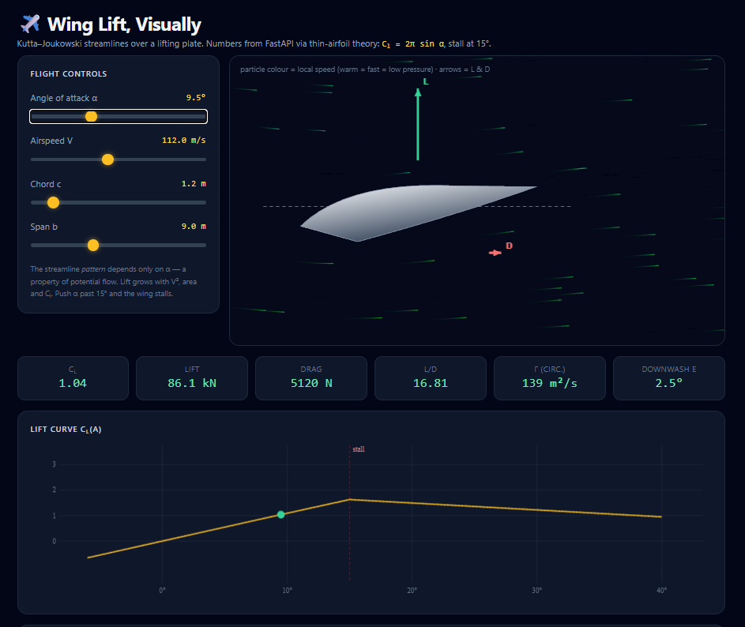
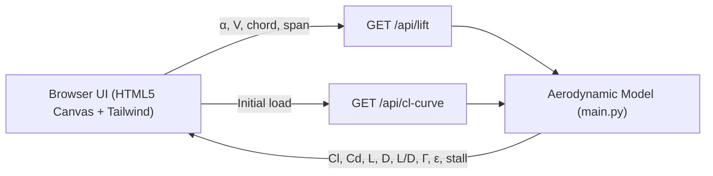

# Wing Lift & Drag Demo

An interactive web visualization of **wing lift and drag**, combining a Python **FastAPI** aerodynamics backend with a real-time **HTML5 Canvas** flow simulation and **Tailwind CSS** dashboard.



> [!NOTE]
> The streamline pattern in potential flow depends only on the angle of attack (`α`), while total aerodynamic forces scale with dynamic pressure (`½ ρ V²`), wing area (`S = b · c`), and the lift/drag coefficients (`Cl`, `Cd`).

---

## Overview

This project visually demonstrates how wings generate lift and experience drag across varying flight conditions:

- **Real-Time Kutta–Joukowski Flow Visualization:** Renders 650+ particles flowing along analytic potential-flow streamlines over a lifting surface. Particle colors map to local flow speed (warm hues indicate faster flow and lower pressure/suction on the upper surface; cool hues indicate slower flow).
- **Force Vectors:** Displays live **Lift (`L`)** and **Drag (`D`)** force arrows directly on the airfoil canvas.
- **Interactive Flight Controls:** Adjust key aerodynamic and geometric parameters in real time:
  - **Angle of attack (`α`):** `-6°` to `40°`
  - **Airspeed (`V`):** `5` to `250 m/s`
  - **Chord length (`c`):** `0.4` to `8 m`
  - **Wing span (`b`):** `1` to `24 m`
- **Live Aerodynamic Telemetry:** Computes and displays Lift coefficient (<code>C<sub>l</sub></code>), total Lift (`L`), total Drag (`D`), Lift-to-Drag ratio (`L/D`), Kutta–Joukowski circulation (`Γ`), and induced downwash angle (`ε`).
- **Lift Curve Chart (<code>C<sub>l</sub>(α)</code>):** Plots the full lift curve including the stall threshold at `15°` and highlights the current operating point.

---

## Architecture



---

## Aerodynamic Model

The backend ([`main.py`](main.py)) computes aerodynamic forces at standard sea-level air density (`ρ = 1.225 kg/m³`):

### 1. Lift (<code>C<sub>l</sub></code> and `L`)

- **Pre-stall (`|α| ≤ 15°`):** Uses classic thin-airfoil theory:
  ```text
  Cl = 2π · sin(α)
  ```
- **Post-stall (`|α| > 15°`):** Models boundary-layer separation via a linear decay from <code>C<sub>l,max</sub></code> toward 25% of <code>C<sub>l,max</sub></code> at `60°`, triggering a visual `STALL ⚠️` warning in the UI:
  ```text
  frac = max(0, 1 - (|α| - 15°) / 45°)
  Cl   = sign(α) · Cl_max · (0.25 + 0.75 · frac)
  ```
- **Lift Force:**
  ```text
  L = ½ · ρ · V² · S · Cl    (where S = b · c)
  ```

### 2. Drag (<code>C<sub>d</sub></code> and `D`)

Total drag combines three components using aspect ratio `AR = b / c` and Oswald span efficiency `e = 0.85`:

- **Parasitic drag:** Constant zero-lift drag coefficient <code>C<sub>D0</sub> = 0.008</code>
- **Induced drag (lifting-line model):**
  ```text
  CDi = Cl² / (π · e · AR)
  ```
- **Post-stall separation drag (`|α| > 15°`):**
  ```text
  CD_sep = 1.1 · sin(|α| - 15°)
  ```
- **Total Drag Force:**
  ```text
  Cd = CD0 + CDi + CD_sep
  D  = ½ · ρ · V² · S · Cd
  ```

### 3. Circulation & Downwash

- **Circulation (`Γ`):** `Γ = Cl · V · c` (`m²/s`)
- **Induced Downwash (`ε`):** `ε = Cl / (π · AR)` (radians)

### 4. Potential Flow Streamlines ([`templates/index.html`](templates/index.html))

The frontend maps a circle of radius `A = 0.5` in the complex `ζ`-plane to a flat plate in the `z`-plane via the **Joukowski transformation** (`z = ζ + A²/ζ`), superimposing:
1. Uniform freestream flow tilted by `-α`
2. A doublet for flow around the cylinder
3. A point vortex of strength `K = 2A sin(-α)` enforcing the **Kutta condition** so flow leaves the trailing edge smoothly

---

## Project Structure

```text
wing-lift-demo/
├── main.py               # FastAPI backend & aerodynamic calculations
├── templates/
│   └── index.html        # Tailwind UI, Canvas flow simulation & Cl(α) chart
├── pyproject.toml        # Project metadata and dependencies
└── uv.lock               # Locked dependency versions for uv
```

### API Endpoints

| Method | Path | Query Parameters | Description |
| :--- | :--- | :--- | :--- |
| `GET` | `/` | *None* | Serves the interactive single-page visualization ([`templates/index.html`](templates/index.html)). |
| `GET` | `/api/lift` | `alpha` (`deg`), `v` (`m/s`), `chord` (`m`), `span` (`m`) | Calculates `cl`, `cd`, `lift_n`, `drag_n`, `ld`, `gamma`, `downwash_deg`, `q_pa`, and `stalled`. |
| `GET` | `/api/cl-curve` | `step` (`deg`, default `0.5`) | Returns sampled `(alpha, cl)` points across `-6° ≤ α ≤ 40°` along with `stall_deg` and `cl_max`. |

---

## Getting Started

### Prerequisites

- Python 3.11+
- [`uv`](https://docs.astral.sh/uv/) (recommended) or `pip`

### Run with `uv`

```bash
uv run uvicorn main:app --reload
```

### Run with `pip`

```bash
python -m venv .venv

# Windows (PowerShell)
.\.venv\Scripts\Activate.ps1

# macOS / Linux
source .venv/bin/activate

pip install fastapi "uvicorn[standard]"
uvicorn main:app --reload
```

Open **[http://127.0.0.1:8000](http://127.0.0.1:8000)** in your browser.
